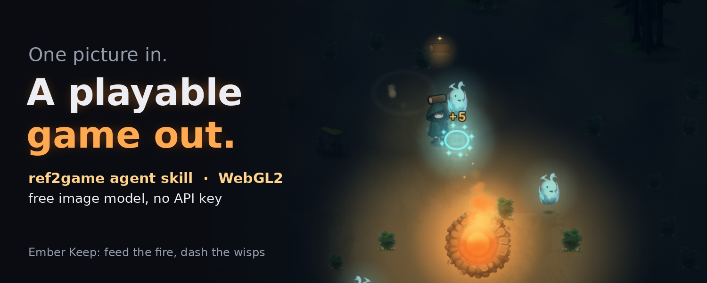
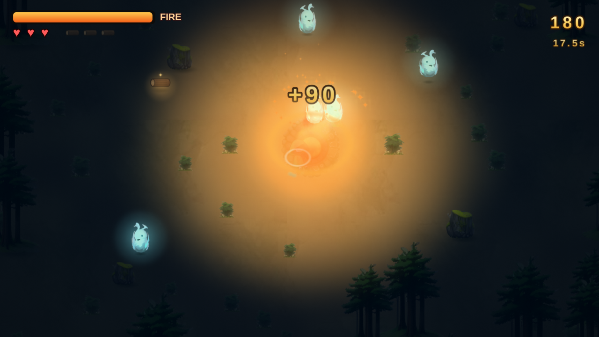
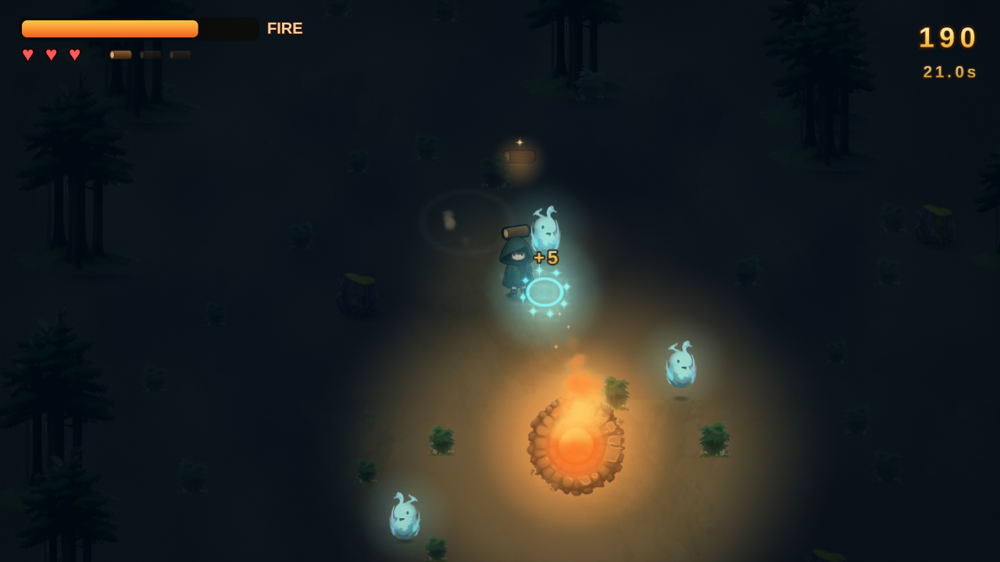
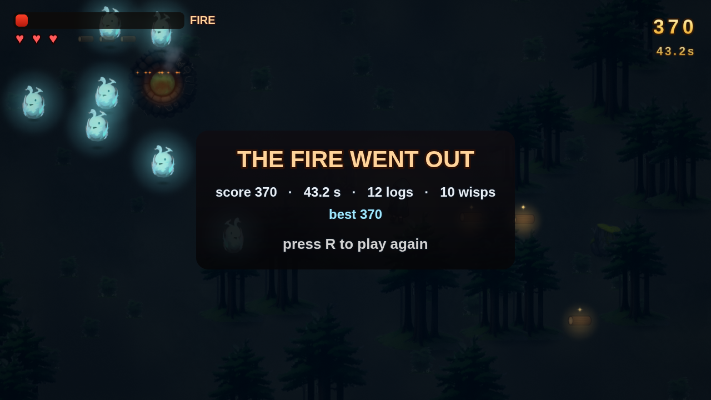
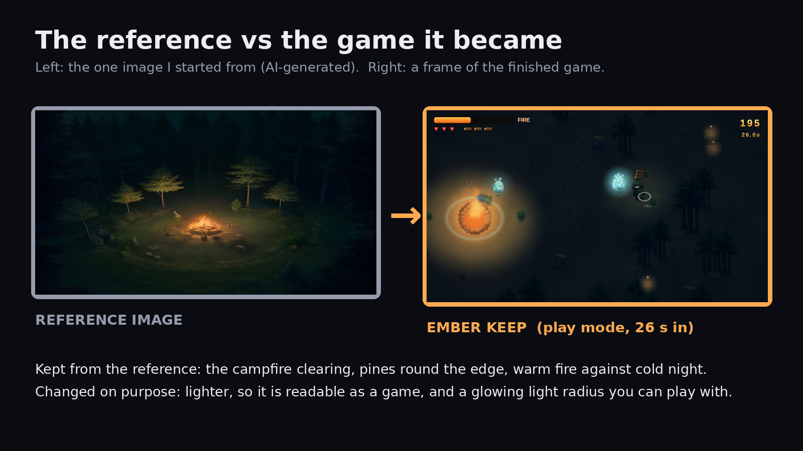

# Ember Keep



Ember Keep is a top-down survival game about one campfire in a dark forest. You run out into the woods, grab logs, carry them back and keep the fire alive. Wisps come out of the dark to eat the fire, and you dash through them to pop them. The fire is your light, so as it dies, your world shrinks. It was built with the [ref2game](https://github.com/studioigor/ref2game) agent skill: one reference image went in, the image model painted the sprites, and everything that moves (light, particles, camera, HUD, game feel) is code running in ref2game's small WebGL2 engine.

## Features

- **Light is fuel.** The light radius grows with fuel, and wisps move at under half speed inside the light.
- **Greed pays, greed hurts.** Carry up to 3 logs. A delivery scores 10, 40 or 90 points for 1, 2 or 3 logs, and wisps nearby hunt you while you carry wood.
- **Dash is your weapon.** Dash through a wisp to pop it for +5 points. Touch one without dashing and you lose a heart and drop your logs.
- **It escalates.** The fire burns faster every second, and wisps spawn more often and move faster.
- **Two ways to lose.** The fire goes out, or you lose all 3 hearts. R restarts and keeps your best score.
- Deterministic sim, kept apart from drawing (`sim.js` holds the rules, `scene.js` the drawing), with an attract-mode autopilot

| Feeding the fire | Dash | Game over |
|---|---|---|
|  |  |  |

## How to run

Serve the repo over HTTP and open the `live/` page:

```bash
python3 -m http.server 8000
# then open http://localhost:8000/live/
```

- Controls: WASD or the arrow keys to move, Space to dash, R to restart
- `?auto=1` lets the autopilot play
- `node live/tune.cjs` runs the attract script headless and checks it still reaches its beats

## Repo layout

| Path | Contents |
|---|---|
| `live/` | the game: `sim.js` (rules), `scene.js` (drawing), plus ref2game's `gl.js` / `lib.js` engine and page shell |
| `live/assets/` | the processed sprites the game loads |
| `art/gen/` | the generated sprites before prep |
| `art/prompts/`, `art/style_bible.txt`, `art/jobs*.json` | the generation prompts and job lists |
| `art/providers/pollinations.py` | the image-provider plugin for ref2game's generator (free anonymous Pollinations endpoint, background removal with rembg) |
| `ref.png`, `ref2game.json`, `study/` | the reference image, the skill config and the reference study |

## Tech notes

These are the numbers measured when the game was built:

- 288 lines of game code: 139 in `sim.js` and 149 in `scene.js`. The engine was used as shipped.
- 42 image requests through the skill's generator, plus 12 manual probes. 7 assets shipped: hero, wisp, pine, rock, fire ring, grass tuft and ground tile. The firewood log is drawn in code.
- 53 fps in headless Chrome and 54 fps for the packed build, with a p50 frame time of 16.7 ms and p95 of 33.3 ms. That's on a CPU software renderer, not a GPU.
- 0 console errors in both the dev build and the packed build.
- Autopilot run: lasted 43.2 s and scored 370, with 12 logs delivered and 10 wisps popped. It's deterministic, so it's the same run every time.



Gameplay video: [media/gameplay.mp4](media/gameplay.mp4)

## Credits

- The code was written by an AI agent following the [ref2game](https://github.com/studioigor/ref2game) skill by studioigor (MIT). The engine files `live/gl.js` and `live/lib.js`, the page shell and `live/tune.cjs` come from ref2game. Its licence is in [licenses/ref2game-LICENSE](licenses/ref2game-LICENSE).
- The sprites and the reference image were generated with [Pollinations](https://pollinations.ai) (free anonymous tier), and the backgrounds were removed with [rembg](https://github.com/danielgatis/rembg).
